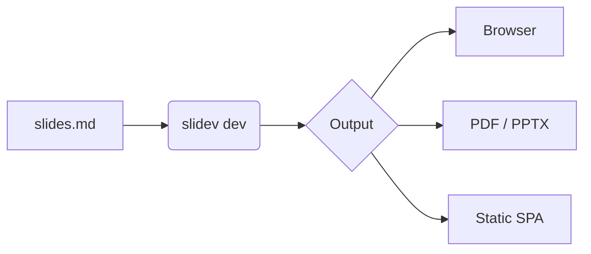
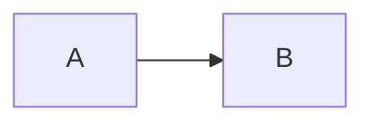
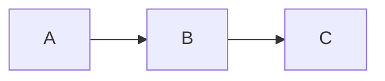
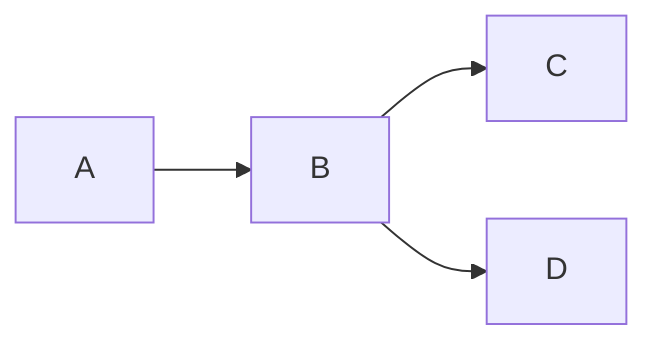

# Slidev by Example

Markdown-powered slides for developers

<div class="pt-12">
  <span class="px-2 py-1 rounded bg-white bg-opacity-10">
    Press <kbd>space</kbd> for the next slide
  </span>
</div>

<!--
Speaker notes go in HTML comments at the end of a slide.
Open presenter mode at /presenter.
-->

---

# What is Slidev?

- 📝 **Markdown** — write slides in a single `.md` file
- 🎨 **Themable** — themes and layouts as npm packages
- 🧑‍💻 **Developer friendly** — code highlighting, live coding
- 🤹 **Interactive** — embed Vue components
- 📤 **Portable** — export to PDF, PPTX, PNG or a static SPA

<v-clicks>

- These bullets…
- …appear one click
- …at a time

</v-clicks>

---
layout: two-cols
---

# Two columns

Left side content goes here.

- Uses the `two-cols` layout
- `::right::` switches column

::right::

```ts {2-3|5|all}
function greet(name: string) {
  const greeting = `Hello, ${name}!`
  console.log(greeting)

  return greeting
}
```

Code line highlighting steps through `{2-3|5|all}` on click.

---

# Diagrams

Mermaid is built in:



---

# Math

Inline $E = mc^2$ and block LaTeX via KaTeX:

$$
\sum_{i=1}^{n} i = \frac{n(n+1)}{2}
$$

---
transition: view-transition
---

# Morphing between slides

<div class="flex items-center gap-4 mt-16">
  <div class="commit" style="view-transition-name: c1">A</div>
  <div class="commit" style="view-transition-name: c2">B</div>
  <span class="label" style="view-transition-name: head">main</span>
</div>

Elements with the same `view-transition-name` on both slides animate between them.

<style>
.commit { @apply w-12 h-12 rounded-full bg-teal-500 text-white flex items-center justify-center font-bold; }
.label { @apply px-2 py-1 rounded bg-orange-500 text-white text-sm; }
</style>

---
transition: view-transition
---

# Morphing between slides

<div class="flex items-center gap-4 mt-16">
  <div class="commit" style="view-transition-name: c1">A</div>
  <div class="commit" style="view-transition-name: c2">B</div>
  <div class="commit" style="view-transition-name: c3">C</div>
  <span class="label" style="view-transition-name: head">main</span>
</div>

`B` stays put, `C` is new and `main` slides along. Works best in Chromium-based browsers.

<style>
.commit { @apply w-12 h-12 rounded-full bg-teal-500 text-white flex items-center justify-center font-bold; }
.label { @apply px-2 py-1 rounded bg-orange-500 text-white text-sm; }
</style>

---

# Swapping figures on click

<v-switch>
  <template #0>



  </template>
  <template #1>



  </template>
  <template #2>



  </template>
</v-switch>

`<v-switch>` shows one template per click, so the same spot can step through several figures.

---

# Moving elements

<div class="flex gap-8 mt-16">
  <div
    v-motion
    :initial="{ x: -80, opacity: 0 }"
    :enter="{ x: 0, opacity: 1 }"
    :click-1="{ x: 200 }"
    :click-2="{ x: 200, y: 80, scale: 1.5 }"
    class="w-16 h-16 rounded-lg bg-teal-500"
  />
</div>

<div class="mt-32">

`v-motion` animates on enter, then to a new state on each click.

</div>

---

# Code that evolves

````md magic-move
```ts
function greet(name) {
  return 'Hello ' + name
}
```

```ts
function greet(name: string) {
  return `Hello, ${name}!`
}
```

```ts
function greet(name: string, excited = false) {
  const greeting = `Hello, ${name}!`
  return excited ? greeting.toUpperCase() : greeting
}
```
````

Magic Move animates tokens between code blocks on click.

---
layout: center
class: text-center
---

# Thanks!

`npm run dev` · `npm run build` · `npm run export`
