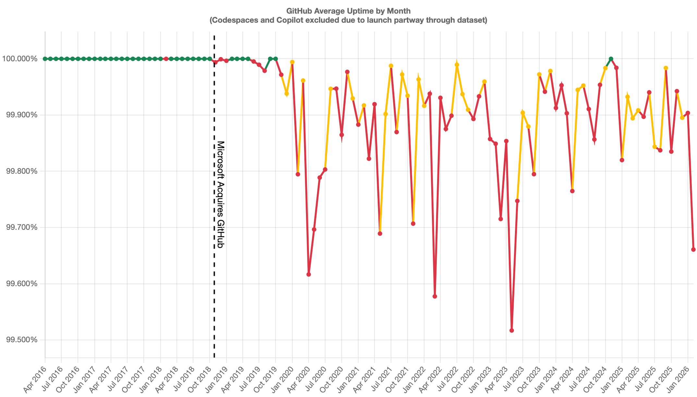
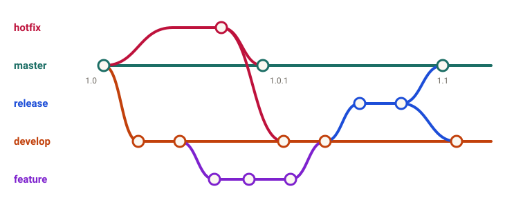
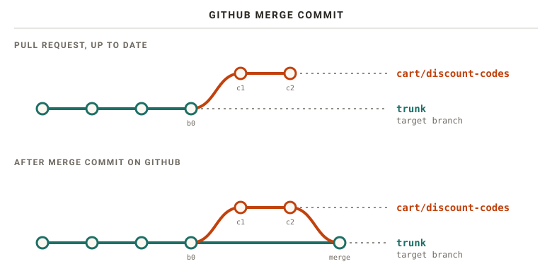
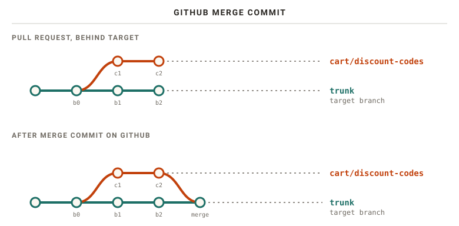
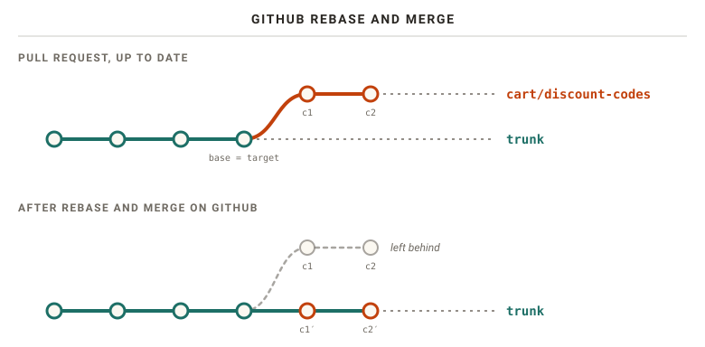
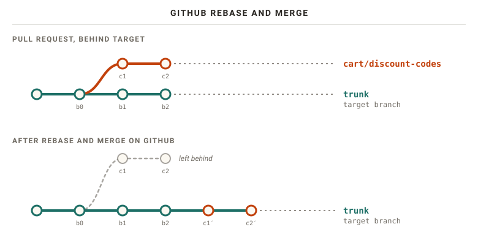
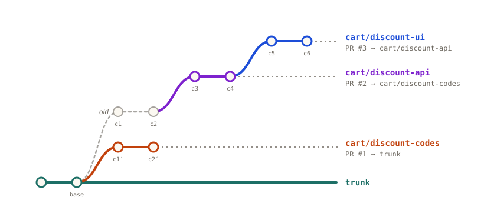
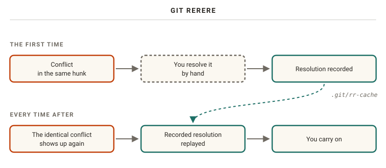

# {{ $slidev.configs.title }}

Why We do What We Do

<div class="pt-8 opacity-60">{{ new Date($slidev.configs.date).toLocaleDateString('en-US', { dateStyle: 'long', timeZone: 'UTC' }) }}</div>

<!--
An opinionated walk through of version control systems, and how to use them.
Mostly Git, with some honorable mentions on how we got to today's workflow, and where it might go next.
-->

---
layout: section
---

# History

---

# 1972 → 2005

<div class="grid grid-cols-[6rem_1fr] gap-y-3 mt-8 text-xl">

<div v-click="1" class="font-mono opacity-60">1972</div><div v-click="1"><b>SCCS</b> · lock the file</div>
<div v-click="2" class="font-mono opacity-60">1982</div><div v-click="2"><b>RCS</b> · still local</div>
<div v-click="3" class="font-mono opacity-60">1990s</div><div v-click="3"><b>CVS</b> · <b>Subversion</b> · <b>TFS</b> · client-server</div>
<div v-click="4" class="font-mono opacity-60">2002</div><div v-click="4"><b>BitKeeper</b> · Linux kernel</div>
<div v-click="5" class="font-mono opacity-60">2005</div><div v-click="5"><b>Git</b> · <b>Mercurial</b></div>

</div>

<!--
[click] 1972: SCCS, Source Code Control System. The first VCS purpose-built for source code. IBM 370 first, then PDP-11 on Unix a year later.
Purely local. No server, no network. The history of each file lives next to it on a single shared machine everyone logs into.
To change a file, you lock it. Nobody else touches it until you're done. A coordinated dance of who has which files locked.

[click] 1982: RCS, Revision Control System. Same premise, still local.

[click] CVS started as scripts on top of RCS, and dropped the locking. Everyone edits their own copy; conflicts merged on check-in. Mid-90s it got client-server support: share a server, not a machine.
Subversion set out to be a better CVS. Same model. Still widely used in enterprise.
Microsoft's Team Foundation Server: server workspaces (read-only until checked out, lockable — the old days) and local workspaces (CVS style).
All of these are centralized: one server holds the one true history. You need it to commit, branch, even read the log.

[click] Distributed VCS existed in the 90s (Sun's TeamWare), but caught on after 2000. BitKeeper, by Larry McVoy (who also designed TeamWare), mattered because the Linux kernel used it 2002–2005.
The free license was revoked...

[click] ...and multiple alternatives were built at the same time. Mercurial is still around. Git won the adoption race.
-->

---
layout: section
---

# Centralized Distributed Version Control

<!--
Git gave us distributed version control. But we often still want one canonical truth.
You can host your own: git itself and the Linux kernel do, on git.kernel.org. With thousands of derivatives built on top.
Most people don't want to run that infrastructure.
-->

---

# SourceForge, 2008


<!--
SourceForge launched in 1999: software discovery plus hosting for a range of client-server VCS.
For a decade, "download it from SourceForge" was how you got open source software.

It was a cluttered mess. Git support only arrived in 2009, as one choice among many.

From 2008, a newcomer called GitHub innovated on the social side of coding: forks, pull requests, contributor profiles. Clean, and built for developers.
By 2011 GitHub had passed SourceForge and Google Code in activity.
-->

---

# **Git**Hub

<v-clicks>

- 2010: SVN support
- 2024: SVN sunset
- 225M developers · 800M repos · 90% of Fortune 100

</v-clicks>

<!--
GitHub is the de facto open source hub. It dethroned SourceForge before there were alternatives.

[click] Fun fact: in its quest for mainstream adoption, GitHub announced Subversion support in 2010. (github.blog/2010-04-01-announcing-svn-support — yes, April 1st, but it was real.)

[click] Sunset in 2024.

[click] Today, per their about page: 225M+ developers, 4M organizations, 800M repositories. Eightfold growth in developers in under a decade. A new developer joins every second, according to Octoverse.
-->

---

# 2018: Microsoft buys GitHub

<div class="text-5xl font-bold mt-16 text-center">#movingtogitlab</div>

<div v-click class="text-3xl mt-12 text-center opacity-80">50 000 / 85 000 000 = <span class="text-teal-500">0.06%</span></div>

<!--
Mid 2018. Scarred developers remembered 1990s Microsoft: "embrace, extend, extinguish". They were not quiet.
#movingtogitlab trended on Twitter. GitLab saw 10x its normal daily imports, and leaned into it with heavily discounted plans.
By the end of the following week, over 50,000 projects had moved.

[click] Sounds like an exodus. But GitHub hosted 85 million repositories. 0.06%. It never registered on the Richter scale.
-->

---

# GitHub uptime



<!--
Even if the exodus crowd was tiny, they might have been on to something. When Big Tech enters the picture, things get shaken up.
Historic uptime graph, built solely from GitHub's own status page (damrnelson.github.io/github-historical-uptime).
Caveat: the further back we look, the more incomplete the data may be.
-->

---

# Back to centralized

<v-clicks>

- GitHub · GitLab · Bitbucket · Azure DevOps
- Codeberg · SourceHut · Gitea

</v-clicks>

<!--
With all the features around collaborating on software, we've almost removed the distributed nature of our VCS. We depend on the platform.
Exception: Git and the Linux kernel themselves. Still patches over mailing lists. More on that later.
The only thing separating us from the old client-server model: we can pack up and leave, or juggle multiple remotes.

[click] The big ones.
[click] And some alternatives.
-->

---
layout: section
---

# What Even Is Trunk

---

# Delta chain → trunk

<v-clicks>

- 1975: "delta chain" (Rochkind)
- 1977: "trunk" & "branch" (SCCS/PWB manual)
- 1985: RCS: "A young revision tree is slender"
- 2020: `init.defaultBranch`

</v-clicks>

<!--
Where do "branch" and "trunk" come from?

[click] The original SCCS paper by Marc Rochkind, 1975, talks about "delta chains". No branches.

[click] The SCCS/PWB User's Manual, Bell Labs 1977, on SCCS v4: "It is convenient to conceive of the deltas applied to an SCCS file as the nodes of a tree... Such a structure may be termed the 'trunk'... there are situations in which it is necessary to cause a branching in the tree."
So the terms came from SCCS, after the first release.

[click] Tichy's RCS paper, 1985: "A young revision tree is slender: It consists of only one branch, called the trunk. As the tree ages, side branches may form."
CVS and Subversion took it from there. Mercurial went with "default". Git with "master".

[click] Git 2.28, 2020, added init.defaultBranch. The default hasn't changed yet, but your config may have.
-->

---


<!--
A nice visual metaphor: a single stem, with branches springing out of it.
-->

---
layout: section
---

# Git Good

---
layout: center
class: text-center
---

# Learn the CLI

<!--
Before we get into the how: invest the time to learn Git on the command line.
I have never really met a GUI-only Git user with a thorough grasp of how Git works.
They are often unable to make the adjustments needed to follow the team's development guidelines: rebasing, splitting commits, fixing up history.
The GUI is fine for looking. The CLI is where you learn the model.
Everything in the rest of this talk is a CLI command.
-->

---

# Streamed Lines, 1998

<div class="grid grid-cols-2 gap-12 mt-8">
<div>

### Patterns

<v-clicks>

- Branch per Task
- Codeline per Release
- Mainline
- Merge Early and Often

</v-clicks>
</div>
<div>

### Pitfalls

<v-clicks>

- Merge-a-phobia
- Branch-a-holic
- Spaghetti Branching
- Continual Cascading

</v-clicks>
</div>
</div>

<!--
Branching strategies are not a Git invention.
"Streamed Lines: Branching Patterns for Parallel Software Development" — Appleton, Berczuk, Cabrera, Orenstein, 1998.
Reading the catalog of patterns today is uncanny. The patterns we still argue about in PRs were named 25+ years ago.

[click] Branch per Task: each change on its own branch.
[click] Codeline per Release.
[click] Mainline: one primary codeline everything joins back into.
[click] Merge Early and Often. Needs no explanation.

Equally valuable, the traps and pitfalls:
[click] Merge-a-phobia
[click] Branch-a-holic
[click] Spaghetti Branching
[click] Continual Cascading: branches branching off "into a wider and wider project-version-tree without ever 'coming back home to roost'".
-->

---

# Story time: the release matrix

<div class="grid grid-cols-2 gap-4 mt-12 text-xl">
<div v-click>🖥️ server generation</div>
<div v-click>🔌 PCIe card version</div>
<div v-click>🐧 SLES version</div>
<div v-click>⚙️ orchestration software</div>
</div>

<div v-click class="text-3xl text-center mt-12">× every customer</div>

<!--
I worked at a company delivering off-the-shelf hardware with custom PCIe cards for a very particular workload. We wrote both the hardware integration software and the orchestration software on top.

Four things evolved over time:
[click] the generation of servers we bought and delivered,
[click] the versions of the custom PCIe cards,
[click] the OS, based on SUSE Linux Enterprise Server,
[click] the orchestration software on top.

A compatibility matrix in itself.
[click] On top of that, many customers got a customized bundle. Every delivery was its own unique permutation.

Each repository produced a SemVer-like version per component, as RPMs. But whenever someone decided some incompatible change was warranted, we forked a numbered release branch on ALL repositories. Hundreds of repos, most forked with no substantial changes. Some with no changes at all.
Releasing was a nightmare, and the recurring bugs were many. Continual Cascading, live.
-->

---

# git-flow, 2010



<!--
Many popular strategies today are remixes of those patterns, adapted to Git's cheap branching and merging.
Vincent Driessen's blog post "A successful Git branching model", 2010. Git wasn't even five years old.
Two infinite branches: master (production-ready) and develop (integration branch for the next release).
Short-lived supporting branches: feature branches off develop, release branches off develop, hotfix branches off master. Release and hotfix merge back into both.
It became immensely popular.
-->

---
layout: quote
---

# Consider your own context. Don't be hating. Decide for yourself.

Vincent Driessen, 2020

<!--
So popular that ten years later, Driessen added a note to the top of his post:
"git-flow has become hugely popular... to the point where people have started treating it like a standard of sorts — but unfortunately also as a dogma or panacea. If your team is doing continuous delivery of software, I would suggest to adopt a much simpler workflow (like GitHub flow) instead."

git-flow was designed for explicitly versioned software, with multiple versions in the wild. Not the continuously delivered web apps most of us build.
It's not every day the author of a pattern publicly tells the industry to reconsider it.
-->

---
layout: center
class: text-center
---

# Trunk Based Development

<!--
GitHub flow is GitHub's packaging of trunk based development. Another callback to "trunk".
The practice existed in the 90s (Streamed Lines' Mainline). The term itself is of unknown origin.

Probably the most widely employed branching (or lack thereof) technique today.
Everyone develops towards one trunk. The branch is a pro forma: a way to share work and gather feedback on whether it meets our shared criteria for trunk.
It also avoids "Works on my machine!" when you ask Jon why he pushed a broken commit straight into trunk.
-->

---
layout: center
class: text-center
---

# Trunk is <span class="green">GREEN</span>

<!--
The saying you'll hear.
Every change on a branch runs the full set of verification steps on CI. Nothing reaches trunk without a green check mark.
The branch must be based off trunk, and up-to-date with it. GitHub warns you on the PR when it's not.
We usually run CI on an active PR from our branch towards a target, which is trunk.
-->

---

# `base` & `target`

<div class="grid grid-cols-2 gap-12 mt-16 text-2xl text-center">
<div><b>base</b><br><span class="opacity-60 text-lg">where you branched off</span></div>
<div><b>target</b><br><span class="opacity-60 text-lg">where the PR lands</span></div>
</div>

<!--
Hot tip, new vocabulary.
A branch forks off another branch, not necessarily trunk. The ancestor we forked from is the base, whatever its name.
The target is the receiving end of a pull request.
They can differ. But for merging, it's usually trunk that matters.
-->

---

# Acceptance criteria

<v-clicks>

1. Formatting
2. Linting
3. Warnings as errors
4. Testing

</v-clicks>

<!--
Besides an up-to-date base, what do we check?

[click] Formatting. At some point we simply stopped arguing about tabs and spaces. One deterministic tool erased decades of debate. Even if it's not your taste, it's consistent.

[click] Linting. Run the static analysis. Any violation is no bueno.

[click] Warnings as errors. A warning left in the codebase is a broken window. Broken window theory: you invite more vandalism. Soon there are thousands and nobody looks. Enforce in CI that warnings fail the build. Keep them as warnings locally for a nicer dev experience.
Story time: Rust ships every 6 weeks. Roughly every second release my CI breaks because Clippy added a new default lint that ridicules my code. Fix it and move on. No bit rot here!

[click] Testing. Run as much as you can on CI.

There's a trade-off with speed. CI easily runs into tens of minutes. PRs have ordering constraints, people waiting, hotfixes that need to go out ASAP.
-->

---
layout: section
---

# Merge strategies

<!--
Once the PR is green against target, how do the changes get there?
Merge commit: a special commit bringing branch and target together. Three-way merge if target has moved.
Squash & merge: all branch commits combined into one, placed onto target.
Rebase: no merge commit; branch rebased onto target while merging.
Conflicts: GitHub has basic resolution in the UI, but you usually resolve locally and push.
-->

---

# Merge commit

<v-switch>
<template #0></template>
<template #1></template>
</v-switch>

<!--
Up-to-date target first. Nothing extraordinary. The merge commit records two parents, and carries no diff itself. CI on the PR ran on c2, the full set of changes.

[click] Now the branch is behind target. CI tested c2 and is green. But b1 + b2 on trunk combined with c1 + c2 was never tested. No conflicts doesn't mean it works. Trunk can break.
Caveat: only if c2 was pushed before b2 landed. GitHub merges automatically for pull_request triggered workflows.
-->

---

# Squash & merge


<!--
A new commit with the combined changes, placed on top of trunk as if we put it there ourselves.
Same divergence possibility: trunk + branch combination was never tested.
-->

---

# Rebase & merge

<v-switch>
<template #0></template>
<template #1></template>
<template #2></template>
</v-switch>

<!--
First a refresher: a local git rebase. Replays your commits onto a new base.

[click] GitHub, up-to-date target. Even here GitHub creates NEW commits server side; the date metadata changes. Any signed commits from the author are thrown away.

[click] Branch behind target: effectively squash & merge, but keeping individual commits.

My recommendation: Rebase & Merge. Easiest history to work with and understand. More on why that matters in commit hygiene.
-->

---

# Keeping trunk <span class="green">GREEN</span>

<v-clicks>

1. Require up-to-date branches
2. Merge queues

</v-clicks>

<!--
All three strategies can leave an untested combination on trunk. That breaks our mantra.

[click] GitHub ruleset: the branch must be up-to-date with target before merging. Removes every untested combination. Cost: authors manually rebase, CI runs again.

[click] Merge queues: each PR runs on a special merge branch, testing the combined result before it lands. Can batch approved PRs into a train. (GitLab calls them Merge Trains.) Automatic when there are no conflicts, at the cost of more CI runs.
-->

---
layout: section
---

# Commit History Hygiene

<!--
Why care? Because we read commits again. Reviewing a PR commit by commit. git blame, to see why a line looks like it does. Hunting regressions with bisect.
A messy history makes all of these harder.
-->

---

# How bad can it get?

<Todo>Screenshot: commit history from AI portal local development</Todo>

<!--
TODO: walk through the screenshot. Don't do it like this.
-->

---

# `git ol`

```bash
git config set --global alias.ol "log --oneline --format='%Cred%h%Creset -%C(yellow)%d%Creset %s %Cgreen(%cr) %C(bold blue)<%an>%Creset'"
```

<Todo>Screenshot: <code>git ol</code> output</Todo>

<style>
/* The alias is one long line; keep it on screen. */
.slidev-code { --slidev-code-font-size: 10px; }
</style>

<!--
Hot tip. Commit titles are what you see when skimming history, so make skimming easy.
git ol: compact one-line log with hash, branch and tag names, title, age and author.
-->

---

# Story time: `git blame`

<v-clicks>

- Bug report → obvious fix
- `git blame` → it was us
- The commit said why

</v-clicks>

<!--
An 'Aha' moment early in my career, same job as the release matrix.

[click] A customer reported behaviour at odds with what they wanted. Easy to track down to a single function. We knew what was wrong and the obvious fix.

[click] We eagerly ran git blame, to find the culprit and lay shame upon thee. It was us. Over a year ago.

[click] And the commit was well documented: the reasoning came from a different project delivery, a different customer, with a slightly different expectation.
Without reading it, we'd have "fixed" it, and introduced a bug for the other customer, who'd find out whenever they next got a software update.
Good on us for writing decent commits!
-->

---
layout: quote
---

# Separate each logical change into a separate patch.

Linux kernel, Submitting patches

<!--
Two desires at odds: one idea per commit, and small commits that are easy to read.
The kernel's rule of thumb continues: "if you make a single change to numerous files, group those changes into a single patch."
Renaming a function across 40 files: one commit. A bug fix and a perf improvement in the same file: two.
-->

---

# Every commit builds. Every commit is correct.

```text {all|1-2|3|4}
feat(cart): add discount code model
feat(cart): apply discount codes to the order total
test(cart): cover expired and unknown discount codes
docs(cart): document the discount code API
```

<v-click at="4">

[Conventional Commits](https://www.conventionalcommits.org)

</v-click>

<!--
Not up for debate. Not just the last commit on your branch: all of them. Otherwise you break bisect for whoever comes after. The kernel: "they will not thank you if you introduce bugs in the middle".

Doesn't mean every commit is complete.
[click] The feature works on its own...
[click] ...tests can come after the code they test...
[click] ...docs too. Each commit before is still correct; just not tested or documented yet.
Tests must come after (or with) the code, or you have a failing commit. At odds with TDD if you commit tests first.

The prefixes are Conventional Commits: feat, fix, test, docs, with an optional scope. They'll pay off again in software release.
-->

---

# `git rebase -i trunk`

````md magic-move
```text
pick 3f1c2a9 Add discount code model
pick 8b7d4e1 Validate dicsount codes
pick 9c0d1e2 WIP: debug logging
pick 5e6f7a8 Fix typo in discount code model
```

```text
pick 3f1c2a9 Add discount code model
pick 5e6f7a8 Fix typo in discount code model
pick 8b7d4e1 Validate dicsount codes
pick 9c0d1e2 WIP: debug logging
```

```text
pick 3f1c2a9 Add discount code model
fixup 5e6f7a8 Fix typo in discount code model
reword 8b7d4e1 Validate dicsount codes
drop 9c0d1e2 WIP: debug logging
```
````

<v-click at="2">

`pick` · `reword` · `edit` · `squash` · `fixup` · `drop` · `exec`

</v-click>

<!--
How do we get history into shape? If there's one git command worth learning properly, it's interactive rebase.
A plain rebase replays commits as-is. Interactive hands you the list in your editor first. Start from the last commit you want to keep, usually the branch base.
The todo list: one line per commit, oldest at the top.

[click] "These lines can be re-ordered; they are executed from top to bottom." Move the typo fix under the commit it fixes.

[click] Then change the commands.
pick: replay untouched. reword: edit the message. edit: stop after it, to amend or split. squash/fixup: meld into the previous one (squash combines messages, fixup keeps the previous). drop: gone. exec: run a command, like your tests.
Save, close. Typo fix disappears into its commit, the misspelled message gets a second chance, the debug logging is gone.

Every rewritten commit gets a new id. Fine on your branch; rewriting what others built on will ruin their day.
-->

---

# `--update-refs`

```bash
git config set --global rebase.updateRefs true
```

<!--
Hot tip. Git 2.38 (2022). Rebase force-updates any branches pointing at commits being rebased.
Very handy once we stack branches. The todo list gets update-ref lines marking where each branch sits.
-->

---

# Fix up my history

````md magic-move
```bash
git commit --fixup=3f1c2a9
```

```text
fixup! Add discount code model
```

```bash
git rebase -i --autosquash
git config set --global rebase.autoSquash true
```
````

<!--
We moved the typo fix by hand. Git can do the bookkeeping.

[click] A fixup commit, titled "fixup! <original title>". It "changes the content of <commit> but leaves its log message untouched".

[click] With --autosquash, every fixup commit is moved right after its target and marked fixup. Just save and close. Configure it globally.

When? During PR review, only add NEW commits. Your reviewer already read the code; let them review only what changed, not play spot-the-difference with a force push. Make those new commits fixup commits.
Once all feedback is addressed and reviewers are happy, autosquash right before merging.
Note: that triggers another CI run, and depending on settings, may dismiss approvals.
-->

---
layout: section
---

# Stacking the Deck

<!--
Merge strategies and fixups work per PR. How do we scale?
As the team grows, work outpaces review. Either progress slows from context switching, or the PR grows into an insufferable amount of code for the reviewer.
-->

---

# Patch series

<div class="font-mono text-xl mt-10 space-y-2">
<div>[PATCH 1/5] …</div>
<div>[PATCH 2/5] …</div>
<div class="opacity-60">⋮</div>
<div v-click>[PATCH v2 1/5] …</div>
</div>

<!--
Not a new problem. Before PRs, open source sent patches over mailing lists. Dependent work goes out as a numbered patch series. Each reviewed on its own merits, applied in order.
[click] Feedback? Rework the relevant patch, resend the whole series as v2. The kernel works this way today. git format-patch implements it natively.
Every new version usually gets rebased on latest upstream — resolving the same conflicts again. Remember that; we'll get to rerere.

Also why internet warriors insist on ~75 character lines in commit messages. Those pesky mailing lists! *shakes fist*
-->

---

# Stacks of patches

<v-clicks>

- 2002 · Andrew Morton's scripts → `quilt`
- 2005 · StGit, "quilt for git"
- 2005 · Mercurial Queues
- 2018 · Stacked Diffs (Phabricator)

</v-clicks>

<!--
Developers keep a series in shape as a stack of patches on top of upstream, pushing and popping.
[click] First automated, as far as I can tell, by Andrew Morton in 2002 for the fast-moving kernel tree. Became quilt; mailing list from 2003.
[click] Two months after Git was born: Catalin Marinas, "Stacked GIT 0.1 (a.k.a. quilt for git)". StGit is still developed today.
[click] Around the same time, Mercurial Queues, also inspired by quilt.
[click] Plaintext patch files get tedious. Facebook's Phabricator: Jackson Gabbard's 2018 post on Stacked Diffs.
-->

---
layout: quote
---

# Units of code review are individual commits

Jackson Gabbard, 2018

<!--
"The typical workflow is to work right on top of master, committing to master as you go. For each of the commits, you then use the Phabricator command line tool to create a 'Diff'..."
"you update the single commit in place."
"The big 'aha!' idea here is that units of code review are individual commits and that those commits can stack arbitrarily, because they're all on one branch."

Feedback is amended into the commit it belongs to, not "Addresses feedback" or "tweaks" commits that only make sense read together.
Your work is "a queue of changes ahead of master", each reviewed and landed on its own.
-->

---

# Stacked pull requests


<div v-click class="text-center opacity-70">GitHub GA: Oct 6, 2026</div>

<!--
On GitHub, a PR is a branch, so the stack is a chain of branches, each PR targeting the one below.

Gabbard didn't invent patch series. But by then, GitHub flow was the norm for a generation that never saw patch queues. Old practice, new clothes. It shifted the mental model.
[click] Which eventually got GitHub to ship native stacked pull requests. Generally available October 6th. Last week!

Our ideals pull in different directions now. Stacked diffs: one commit per unit, amended in place. Reviewers: new commits to see what changed. Everyone: clean trunk.
On GitHub the commits ARE the review history. I think we forgot that, and review PRs as a whole. But commits are our tools' primary unit.
-->

---

# Amending the middle



<v-click>

```bash
git rebase cart/discount-codes -Xours
```

</v-click>

<!--
Feedback often lands in a middle layer. Amend directly or fold in a fixup: the layer's commits are rewritten, and everything above stands on the old ones.

[click] Hot tip: you KNOW the changes are compatible, you wrote both versions. From cart/discount-api, rebasing onto cart/discount-codes replays old c1, c2 on top of c2′ — that's the conflict. During rebase "ours" is what you're rebasing onto, so -Xours makes c1′ and c2′ win.

Better: avoid it. Autosquash rebase from the top of the stack with --update-refs, every layer moves in one go. You may still get conflicts if fixups moved within a branch and later commits touch the same lines; edit mode makes inserting fixups mid-layer easier.

Trunk discipline: the kernel only accepts finished work with a real user. Greg Kroah-Hartman: "we don't try and add code to the kernel that's not used". Stacks mean any layer may merge any time, so each layer must leave trunk working and releasable. Takes discipline.
-->

---

# ReReRe

```bash
git config --global rerere.enabled true
```



<!--
Your stack drags on, tons of feedback, trunk keeps moving. You rebase. Again and again.
Greg Kroah-Hartman: "On average, it takes at least three tries to get a patch accepted into the kernel. I've had some patch series that's taken like 25 times."
Every round is a chance to resolve the exact same conflict again. Rebasing hell.

git rerere: reuse recorded resolution. Resolve once by hand, Git records conflict + resolution, and replays it next time. Off by default.
Lifesaver for long-lived branches: a series in round 25, or a develop branch reconciled with trunk over and over.

But it's a band-aid. If you need it, your branches lived too long. Unless you have to — then you'll be glad it exists.
-->

---
layout: section
---

# Toolbox

---

# `git reflog`

```text {all|6}
ea09dd2 HEAD@{0}: rebase (finish): returning to refs/heads/cart/discount-codes
ea09dd2 HEAD@{1}: rebase (reword): Validate discount codes
dd9a2db HEAD@{2}: rebase (reword): Validate dicsount codes
6413bb1 HEAD@{3}: rebase (fixup): Add discount code model
141b872 HEAD@{4}: rebase (start): checkout trunk
5e6f7a8 HEAD@{5}: commit: Fix typo in discount code model
```

<v-click>

```bash
git reset --hard HEAD@{5}
```

</v-click>

<!--
Barfed a rebase, a merge, god forbid a reset --hard? Reflog saves you — if your changes were committed.
Every time HEAD or a branch tip moves, Git notes where it pointed. Here's the reflog after the interactive rebase from earlier, newest first.

[click] HEAD@{5}: right before the rebase started.
[click] Put it back. Or look first: git branch rescue HEAD@{5}.

Local to your clone, never pushed: can't save you from someone else's force push (their reflog can). Entries expire: 90 days, 30 for unreachable commits.
You will be very happy this exists one day.
-->

---

# `git cherry-pick s1..s3`


<!--
Sometimes you want some commits, not a whole branch. "Apply the change each one introduces, recording a new commit for each."
A couple of commits on the spike/discounts experiment were keepers; you want them on cart/discount-codes.
Range syntax: s1..s3 is ancestors of s3 but not of s1, so s2 and s3. Include s1 with s1^..s3.
s2′ and s3′ are brand new commits; the branches aren't joined. Conflicts if the code has drifted.
-->

---
clicks: 9
---

# `git bisect`

<BisectDemo :step="$clicks" />

<!--
Bug report: discount code applied twice when changing quantity in the cart. Worked in v1.0. No test caught it, so you write one now. It fails on trunk, as expected.

[click] repro.sh isn't committed, so it stays in place when you check out older code. On v1.0 it passes: the bug arrived in one of the 16 commits since.

[click] You could run the new test on every commit, one at a time. Up to 15 runs here, and real histories are much longer.

[click] Instead, tell Git one bad commit and one good one. Every commit after the good one is a suspect, and Git checks out the one in the middle. Binary search: a thousand commits take about ten rounds.

[click] The test passes on 73fbb96, so the bug came later. One run cleared half the suspects.

[click] 28e4e6b doesn't even build, so it tells you nothing. git bisect skip sets it aside, and Git checks out a neighbour instead.

[click] 6bad2b8 fails, so the bug is here or earlier. The skipped commit is still a suspect; bisect works around it.

[click] e4280cf passes. Only ef64843 and the skipped one are left. One more run decides it.

[click] ef64843 fails, and the commit before passed. First bad commit, found in 5 runs instead of up to 15, even with a commit that didn't build. Recalculating the total applied the discount on top of an already discounted total.

[click] git bisect reset takes you back to trunk. Commit the fix together with the new test, so it can't come back unnoticed.

If the test is scriptable: git bisect run ./repro.sh. Exit codes control good/bad/skip.
Bisect is only as good as your commits. Every commit that doesn't build is a gap. A 4000-line commit tells you when, not why.
Story time: I've only really needed this once in my career. Very useful that one time!
cargo-bisect-rustc takes it further: downloads pre-built compilers, narrows to a nightly, then to the PR.
-->

---

# `git ((sub|work)tree|submodule)`

<div class="grid grid-cols-3 gap-8 mt-12 text-center text-xl">
<div v-click><b>subtree</b><br><span class="text-base opacity-60">copy, history and all</span><br><span class="text-base opacity-60">→ josh</span></div>
<div v-click><b>submodule</b><br><span class="text-4xl">🙅</span></div>
<div v-click><b>worktree</b><br><span class="text-base opacity-60">many checkouts, one repo</span></div>
</div>

<v-click>

```bash
git worktree add ../discount-api cart/discount-api
```

</v-click>

<!--
Working with multiple repositories, or multiple copies.

[click] git subtree copies another repo into a subdirectory, history and all. Regular files. Cloning just works, cross-boundary changes are atomic, only maintainers need to know, and you can split changes back out with git subtree push.
Cost: syncing upstream, and it's slow on large repos (a 7 year old stale bugfix patch).
josh — Just One Single History — same idea, fast. Keeps history, incremental, both directions.

[click] git submodule: just a pointer to a commit elsewhere. We don't talk about git submodule. Avoid at all costs.

[click] git worktree: nothing to do with other repos. Multiple checkouts of your own. No stash-switch-switch-back dance.

[click] Checks out the branch in a new directory, yours untouched. No duplicated history; commits, branches, stashes visible from both.
Reviewing a PR mid-refactor. Long test suite on one branch while working on another. Letting a coding agent loose in its own worktree.
Rule: a branch can only be checked out in one worktree. Which is also why --update-refs won't move branches checked out elsewhere.
-->

---
layout: section
---

# Software Release

<!--
Green trunk, tidy history, changes ready. They need to reach users. Git doesn't release anything; a release is a point in history with a name: a tag.
-->

---

# Release notes ≠ changelog

<div class="grid grid-cols-2 gap-12 mt-12 text-center">
<div><div class="text-2xl font-bold">Release notes</div><div class="opacity-60">the story</div></div>
<div><div class="text-2xl font-bold">Changelog</div><div class="opacity-60">the record</div></div>
</div>

<v-click>

```text
feat → Features · fix → Bug fixes · test, docs → skipped
```

<div class="text-center opacity-60">git-cliff</div>

</v-click>

<!--
Release notes: the announcement, for humans. What's new, why care, what can you do now. Dolphin Progress Reports are a joy to read even though I've never used the emulator. Real effort, but that's what people read.

Changelog: the complete record. Every user-facing change, per release. Keep a Changelog, grouped by component like the Rust release notes, or your own.

[click] This is where Conventional Commits pay off. git-cliff generates changelogs from them. Read it before you publish; it's only as good as the commit messages.
-->

---

# Tag → release

```bash
git tag -a v1.1.0 -m "v1.1.0"
git push origin v1.1.0
gh release create v1.1.0 --generate-notes ./dist/*
```

<!--
GitHub releases are "based on Git tags". Title, description, assets like binaries or installers. Source zip and tarball for free.
--generate-notes: called "release notes", but it's a changelog: merged PRs, contributors, link to the full changelog.

The tag marks the point. The changelog lists the changes. The release notes tell the story. The assets are what people install.
-->

---

# How we release at work

<Todo>Example from work: cutting a release, and the artifacts we get automatically</Todo>

<!--
TODO: walk through how we cut releases, and what artifacts come out of it automatically.
-->

---
layout: section
---

# Git Contenders

---

# Pijul

<v-clicks>

- Git commit = snapshot
- Pijul change = patch, with identity

</v-clicks>

<!--
Where might VCS go next? Pijul: built on a mathematical theory of patches.

[click] A git commit is not a set of changes. It's a complete snapshot of every file, plus metadata: author, message, parents. The diff you see is computed on the fly. (Compression between similar files is a storage detail.)

[click] Merging: Git compares snapshots to the common ancestor and lines up changes by surrounding text. In Pijul, a change carries where it was applied. A conflict only when the order truly can't be computed.
-->

---
clicks: 8
---

# Git vs Pijul: the same merge

<MergeDemo :step="$clicks" />

<!--
trunk holds a file with two lines, A and B. Each column is that file at one commit.

[click] Alice branches off trunk and commits a change adding G at the top.

[click] She commits again, adding a new A and B above it.

[click] Bob also branches off trunk, never sees Alice's work. He inserts X between A and B.

[click] Alice's branch is merged into trunk first. trunk now holds her version.

[click] Bob's branch still starts from the original trunk. Git merges text, and to Git every A looks the same: put X after an A and before a B.

[click] The first A and B Git finds are Alice's new ones. X lands between them. No conflict. No warning.

[click] Pijul gives every line an identity. Bob's change says: after the ORIGINAL A, before the ORIGINAL B.

[click] X lands where Bob put it.

The problem with innovation like this: it's incompatible with Git. Especially for open source. Enterprises are likelier to run non-git VCS.
-->

---

# Jujutsu (`jj`)

<v-clicks>

- Git as the storage backend
- Everything is a commit
- Automatic rebase
- Stable change IDs
- Conflicts live in commits

</v-clicks>

<!--
So how do you dethrone Git? Be Git-compatible.

[click] jj separates storage from UX and algorithms. Developed on GitHub, using git as backend. Collaborate with a jj user and you'd be none the wiser.

[click] No staging area, no stash. Operations never halt on unstaged changes.
[click] Editing commits is a breeze; descendants are rebased automatically.
[click] A stable change id per changeset, regardless of amends and rebases. Git gives you a new hash every time.
[click] Merges and rebases always complete; conflicts are stored in the commit. Resolve later, and the fix carries forward. A free rerere by design.
-->

---
layout: center
class: text-center
---

# Agents write the code.<br>CI is the guardrail.

<!--
Where this is heading. LLM-driven agents are taking on more and more of the code.
Everything we just covered — trunk is green, every commit builds, formatting, linting, warnings as errors, tests, up-to-date branches, merge queues — used to be good hygiene for humans.
With agents producing code faster than we can read it, it's the contract. The agent doesn't get tired of fixing a lint. Make CI as thorough as you possibly can, and let it say no.
Small commits and stacked PRs also matter more: it's how a human can still review what an agent wrote.
And worktrees let you run agents side by side without trampling each other.
-->

---

# Key takeaways

<v-clicks>

- Short-lived branches off trunk
- Trunk is <span class="green">GREEN</span>
- Stack your PRs
- Rebase & Merge
- One logical change per commit
- Fixup → autosquash
- Conventional Commits
- `git rebase -i`
- Release from tags

</v-clicks>

<!--
[click] Branch off trunk, keep branches short-lived.
[click] Every PR runs formatting, linting, warnings as errors and tests. Require up-to-date branches, or use merge queues. Only merge what leaves trunk releasable.
[click] Split large work into stacked PRs. Each layer easily digestible for a reviewer.
[click] Rebase & Merge for a cleaner history. Downside: you lose signed commits. May be a dealbreaker.
[click] One logical change per commit. Every commit passes CI.
[click] Address feedback with fixup commits, autosquash right before merging.
[click] Conventional Commits for a readable history and a generated changelog.
[click] Interactive rebase is your primary tool for all of the above.
[click] Release from tags: changelog, human announcement, GitHub release with assets.
-->

---
layout: center
class: text-center
---

# Thanks!

[veeg.dev/git](https://veeg.dev/git)

<!--
The long form of this talk is on the blog, including my full ~/.gitconfig in the appendix.
-->
