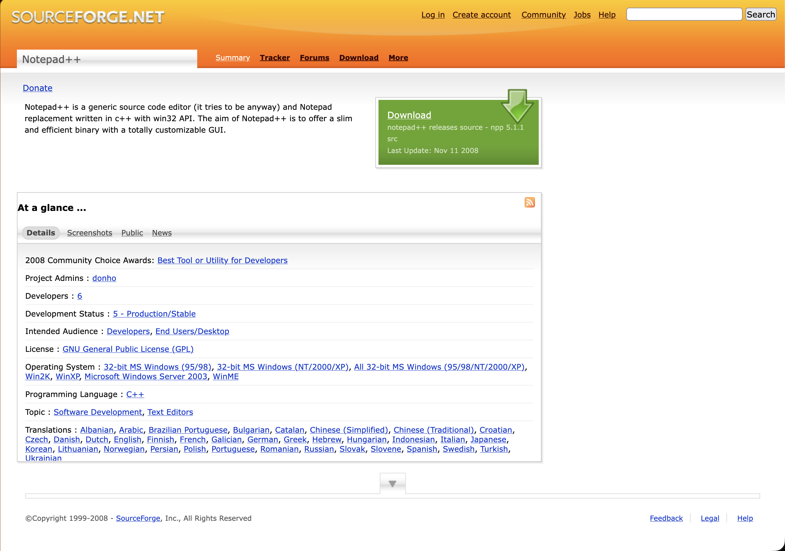
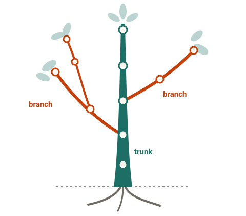
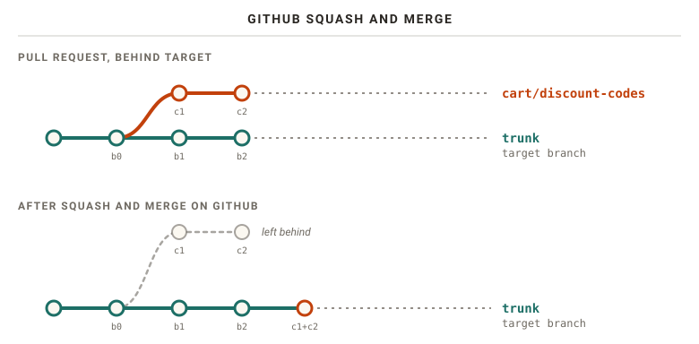
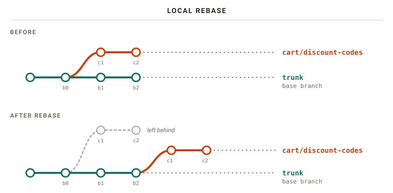
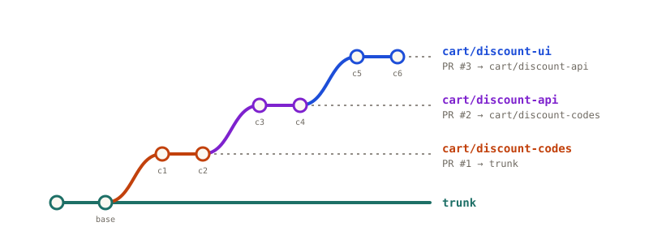
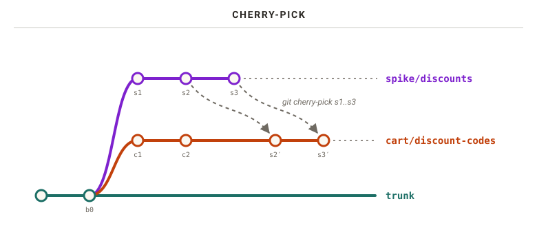

+++
title = "Version Control Systems - Why We do What We Do"
date = 2026-10-13
path = "git"
+++

This is an opinionated walk through of Version Control Systems (VCS) and how to use them. We will focus on Git, but some
honorable mentions on how we got to today's workflow, and how they might change in the future.

<!-- more -->

## History

Eons ago, more specifically in 1972, the first Version Control System (VCS) that was purposefully built for source code
was developed. First for the IBM 370, then rewritten for PDP-11 running on
[Unix](https://www.unix.org/unix_history.html) a year later. It was called `SCCS`, and stood for _Source Code Control
System_. It laid the foundation for a series of successors that were all built on the same premise, or derivations
thereof.

SCCS, and its successor the _Revision Control System_ (RCS) from 1982, were purely local tools. There was no server
and no network protocol. The history of each file was kept in a file next to it, on a single shared machine that every
developer logged into. To change a file, you had to _lock_ it first. Once it was locked to one user, nobody else was
allowed to make changes to that file. Making changes towards a shared project became a coordinated dance of who has
which files locked, for how long, and what changes they did that are compatible with the rest of the source code!

The _Concurrent Versions System_ (CVS) started out as a set of scripts on top of RCS, and dropped the locking. Everyone
edits their own copy, and conflicts are merged when changes are checked in. In the mid-1990s it gained client-server
support, so developers no longer had to share a machine, just a server. [Subversion](https://subversion.apache.org/),
which is still widely used within enterprise organizations, set out to be a better CVS and kept the same model.

Microsoft had a version of their own, called Team Foundation Server, or Team Foundation Version Control. It had Server
Workspaces, where files were read-only until checked out from the server, and could be locked, much like the old days.
It also had Local Workspaces, which operate on the same premise as CVS, with a fully local copy of the files. Conflicts
are handled when the changes are checked in.

These client-server systems can be categorized as _centralized version control_. A single server holds the one true
history, and you need to talk to it to commit, branch, or even look at the log. _Distributed version control_, where
every developer has a full copy of the history, did exist in the 1990s. Sun's _TeamWare_ gave each developer their own
SCCS-based workspace. But it took until the new millennium for the idea to catch on. There were multiple incarnations,
most of which gained little popularity. The most revolutionary was _BitKeeper_, built by Larry McVoy, who had also
designed TeamWare. It was revolutionary not for its popularity or features, but because it was adopted by the Linux
Kernel between 2002 and 2005. Following the revocation of its free license, multiple alternatives were developed
simultaneously.
[Mercurial](https://www.mercurial-scm.org) was one such VCS, which is still actively developed and used. The other is of
course none other than [Git](https://git-scm.com/). Based on the last 20 years of source code on the internet, we can
safely conclude that Git won the majority adoption race.

There are many more version control systems out there for the history books, but the ones mentioned above carry some
historical significance, both in the impact and proliferation throughout the software industry. We will also visit some
[Git contenders at the end of the post](#git-contenders).

## Centralized Distributed Version Control

For all the good that distributed version control systems like Git gave us, one _often_ still needs a canonical truth.
You can host your own git repository server, expose it on the internet, and now that is your canonical copy. In fact,
that is what [git](https://git.kernel.org/pub/scm/git/git.git) and
[linux kernel](https://git.kernel.org/pub/scm/linux/kernel/git/torvalds/linux.git) have done! However, for these projects
there are also _thousands_ of derivative repository servers or machine-local patches built on top of some base derived
from a canonical copy.

However, most people or companies do not want to manage their own infrastructure related to hosting a VCS server. That's
where projects like SourceForge broke ground by hosting such server infrastructure on behalf of project owners. They
launched as early as 1999 with their platform of software discovery and server hosting facilities, supporting a range of
client-server VCS. For the following decade, "download it from SourceForge" was simply how you got your hands on open
source software.

However, it started to lose traction to a newcomer on the scene, ca 2008 and onwards. A small contender on the scene
called **GitHub** started innovating how we collaborate around the _social aspects_ of collaborative coding. It brought
with it the concepts of forks, pull requests, and individual contributors to a web-based platform. All in-all, GitHub
provided a clean, seamless experience that appealed to developers themselves.

SourceForge was a cluttered mess, with late adoption of Git. It only integrated Git support in 2009, and only made it a
sub-selection among many VCS they supported.



Unfortunately, the Wayback Machine doesn't include a representative comparative render of GitHub at the time.

By 2011, GitHub had surpassed SourceForge and Google Code in activity, and SourceForge was largely left for legacy open
source projects.

### The Rise of GitHub

GitHub is the de facto open source code collaboration hub on the internet. It dethroned SourceForge before there were
any alternatives. Funnily enough, in their quest to mainstream adoption, **Git**Hub implemented
[`SVN` repository support](https://github.blog/2010-04-01-announcing-svn-support/) in 2010. This was
[later sunset in 2024](https://github.blog/news-insights/product-news/sunsetting-subversion-support/).

Today, GitHub's [own about page](https://github.com/about) boasts more than 225 million developers, 4 million
organizations and 800 million repositories, and is used by 90% of the Fortune 100. That is an eightfold growth in
developers in less than a decade. According to GitHub's yearly [Octoverse report](https://octoverse.github.com/), a new
developer joins GitHub every second.

### The Bumpy Road

In medio 2018, Microsoft announced the acquisition of GitHub. A lot of scarred developers remembered the 1990-era
Microsoft of ["embrace, extend extinguish"](https://en.wikipedia.org/wiki/Embrace,_extend,_and_extinguish). They were
not quiet about it. The tag `#movingtogitlab` was trending on Twitter, and GitLab saw a ten times increase in its normal
daily volume of repository imports. GitLab leaned heavily into the opportunity with their own marketing, offering
[heavily discounted plans to new users](https://about.gitlab.com/blog/movingtogitlab/). By the end of the week following
the acquisition announcement, over
[50000](https://www.vice.com/en/article/13000-projects-ditched-github-for-gitlab-monday-morning/) projects had been
moved.

This may sound like an exodus. But the crowd was a very vocal minority. At the time of the acquisition, GitHub hosted
[85 _million_ repositories](https://blogs.microsoft.com/blog/2018/06/04/microsoft-github-empowering-developers/). This
accounts for only 0.06% of all repositories. The "exodus" never registered on the Richter scale.

Funnily enough, even if the exodus crowd was tiny, they might have been on to something. When Big Tech enters the
picture, things are bound to be shaken up. This can observed be seen by the
[excellent historic uptime graph](https://damrnelson.github.io/github-historical-uptime/) based solely on data sourced
from GitHub's own official status page.


> NOTE: Uptime data may also be more incomplete the later back we look.

### Back to Centralized

With all the extraneous features surrounding the process of collaboratively building software, we've almost removed the
distributed nature of our version control systems. We are still heavily reliant on the tooling that these centralized
coding platforms provide for us to collaborate. The exception to this rule might of course be Git and Linux Kernel
itself, which still relies on
[archaic mailing lists](https://www.kernel.org/doc/html/latest/process/submitting-patches.html) to submit patches, and
communicate surrounding those patches are also done over mail. More on that later. But for the rest of the industry, a
coding platform is still needed. The only thing that separates the old client-server VCS from our modern distributed
version control is the fact that we can still pack up and leave, or juggle multiple remote servers at once.

Alternatives to the GitHub hosted platform today are [GitLab](https://about.gitlab.com/),
[Bitbucket](https://bitbucket.org/product/), [Azure DevOps](https://azure.microsoft.com/en-us/products/devops),
[Codeberg](https://codeberg.org/explore/repos), [SourceHut](https://sourcehut.org/), [Gitea](https://about.gitea.com/).

## What Even Is Trunk

How has it come to be that we talk about _branches_ and _trunk_ today? Where does that stem from?

If we go all the way back to the [original paper on SCCS](https://www.mrochkind.com/aup/talks/SCCS-Slideshow.pdf)(Marc
J. Rochkind, 1975), the primary reference terminology used was "delta chain". The term branch did not exist in this
context.

The
[SCCS/PWB User's Manual](https://bitsavers.org/pdf/att/unix/PWB_UNIX/Documents_for_the_PWB_UNIX_Time-Sharing_System_Edition_1.0_197710.pdf)(Bonanni
& Glasser, Bell Labs, 1977) has the following to state on SCCS v4:

> It is convenient to conceive of the deltas applied to an SCCS file as the nodes of a tree, in which the root is the
> initial version of the file. […] Such a structure may be termed the "trunk" of the SCCS tree. It represents the normal
> sequential development of an SCCS file, in which changes that are part of any given delta are dependent upon all the
> preceding deltas. However, there are situations in which it is necessary to cause a branching in the tree […] The new
> delta is a node on a "branch" of the tree, and its name consists of four components […] release.level.branch.sequence

Based on the language used, the naming for _branch_ and _trunk_ stem from the development of SCCS, but after Rochkind's
initial release in 1975.

And this terminology stuck with us throughout various VCSs. The introductory paper
[_RCS - A System for Version Control_](https://www.gnu.org/software/rcs/tichy-paper.pdf)(Walter F. Tichy, 1985)
reiterates the terminology:

> 3 ) RCS arranges revisions in an ancestral tree.
>
> 3.1 ) A young revision tree is slender: It consists of only one branch, called the trunk. As the tree ages, side
> branches may form.

Later derivatives and innovations on CVS and Subversion took the term from there. Mercurial ended up with merely
_default_. Git started out on _master_, but in Git 2.28 - released in 2020 - added an `init.defaultBranch`
configuration. The default has not really changed yet, but your configuration may have!

This gives us a nice visual metaphor of a physical tree, with a single stem, and branches springing out of said tree.


## Git Good

All we've talked about til now only really touched on the different VCS out there, but not how we actually work with
them. We also need to deep dive into various approaches to collaborative software development using Git, what are common
approaches for various scenarios, and what is the subjective, modern approach.

### Branch Strategies

Branching strategies are by no means a Git invention.

A paper titled
[_Streamed Lines: Branching Patterns for Parallel Software Development_](https://www.bradapp.com/acme/branching/)(Brad
Appleton, Stephen Berczuk, Ralph Cabrera and Robert Orenstein) from 1998 divulges on organizing lines of development
into "appropriately diverging and converging streams of source code changes". Reading the
[catalog of patterns](https://www.bradapp.com/acme/branching/patterns.html) today is a bit uncanny. There is _Branch per
Task_, where each change task is performed on its own branch. There is _Codeline per Release_, a separate codeline for
each release. There is the _Mainline_, a single primary codeline that all other codelines eventually join back into. And
there is _Merge Early and Often_, which needs no further explanation. The patterns we still argue about in pull requests
today were already named and cataloged more than 25 years ago.

Equally valuable is their list of [traps and pitfalls](https://www.bradapp.com/acme/branching/pitfalls.html), with names
such as _Merge-a-phobia_, _Branch-a-holic_, _Spaghetti Branching_ and _"Big Bang" Integration_. One of them is
_Continual Cascading_, where branches keep branching off "into a wider and wider project-version-tree without ever
'coming back home to roost'".

 I worked at a company that delivered off-the-shelf hardware with custom made PCIe cards for a very
particular workload. We managed both software for the hardware integrations, and the user orchestration software to
provide the value from said cards. Multiple things evolved over time here. 1) The generation of servers we were buying
and delivering 2) the versions of custom PCIe cards 3) The OS version delivered, based on SUSE Linux Enterprise
Server, 4) the orchestration software on top.

This in and of itself is a matrix to keep track of what code is compatible where. On top of this, many of our customers
were given a customized bundle of software to go with their hardware delivery. Effectively every customer delivery was
its own unique permutation.

Our source code repositories produced a SemVer-like version number per component (released as RPM packages). However,
each relevant repository forked off a separate numbered release branch on _all_ repositories whenever someone decided
_some_ incompatible change is warranted. We had hundreds of repositories, most of them forked on individual branches
with _no substantial_ or incompatible changes towards them. Some had no changes at all!

Safe to say, releasing was a nightmare, and the recurring bugs were many!



Many of the branching strategies popular today are a remix of these patterns, adapted to the cheap branching and merging
that Git brought with it. One that took the late adolescence internet with storm was a blog post by Vincent Driessen on
[_A successful Git branching model_](https://nvie.com/posts/a-successful-git-branching-model/) in 2010, a year after he
started using it on his own projects. Git itself was not even five years old at the time. Here he introduces _git-flow_.
The model defines two branches with an infinite lifetime: `master`, which always reflects a production-ready state, and
`develop`, the _integration branch_ holding the latest changes for the next release. Next to these live a set of
short-lived supporting branches. _Feature_ branches branch off from and merge back into `develop`. _Release_ branches
branch off `develop` to prepare a new production release, while _hotfix_ branches branch off `master` to quickly patch
what is running in production. Both release and hotfix branches are merged back into `master` and `develop` alike.


git-flow became immensely popular. So popular, in fact, that ten years later, Driessen added a note of reflection to the
top of his original post:

> In those 10 years, git-flow (the branching model laid out in this article) has become hugely popular in many a
> software team to the point where people have started treating it like a standard of sorts — but unfortunately also as
> a dogma or panacea. […] If your team is doing continuous delivery of software, I would suggest to adopt a much simpler
> workflow (like [GitHub flow](https://docs.github.com/en/get-started/using-github/github-flow)) instead of trying to
> shoehorn git-flow into your team.

git-flow was designed for software that is explicitly versioned, with multiple versions supported in the wild. Not for
the continuously delivered web apps most of us are building with Git today. It is not every day the author of a pattern
publicly tells the industry to reconsider using it. His conclusion is worth repeating:

> To conclude, always remember that panaceas don't exist. Consider your own context. Don't be hating. Decide for
> yourself.

The referenced _GitHub flow_ workflow is GitHub packaging on top of a methodology called _trunk based development_. This
is yet another callback to our original history lesson on the origins of _trunk_. The methodology itself was already
present in the 1990s, as illustrated by the _Streamed Lines_ paper. However, the term _trunk based development_ is of
unknown origins.

The practice itself is perhaps the most widely employed branching (or shall I say lack thereof) technique used for
modern software development. Everyone develops towards one trunk. The branching is merely a proforma for us to publicly
share and collaborate on whether the changes meet our shared criteria to be worthy of being accepted into _trunk_. We
do this for multiple reasons, but prime among them is that we have an injection point to share our work, and gather
feedback. We also avoid the inevitable "Works on my machine!" response you'll get when you ask Jon why he pushed a
broken commit right into trunk.

These acceptance criteria may vary between teams and organizations, but you will often find a shared common thread
wherever you look. We have a saying for this that you may encounter:

> Trunk is <span class="green">GREEN</span>.

All changes on a branch run a full set of verification steps on a continuous integration (CI) platform. No changes are
ever allowed to reach trunk unless all verifications report a green check mark in the UI. The branch itself must be
based off of _trunk_, and the _base_ must be up-to-date within the branch. You will get a warning on the PR that the
branch is not up-to-date if this is not the case. We oft limit the CI run to an active PR of our branch towards a
_target_ branch, whose target is _trunk_.



`base` & `target` are new terms for our vocabulary. A branch is forked off another named branch. This branch does not
have to be trunk. It can be based off of another branch itself. The ancestor branch we forked off is referenced as the
_base_ branch, regardless of what name it has. The _target_ branch is the receiving end of a pull request.

It is possible for _base_ and _target_ to be two different branches. However, for pull requests purposes, when we
actually want to merge our branch, it is usually only relevant against _trunk_.



So, what are the common acceptance criteria besides an up-to-date base within our branch?

1. **Formatting**: At some point, we simply stopped arguing about tabs and spaces. Conformity to a single, deterministic
   tool erased decades of debacle. Even if the output is less than ideal for your personal taste, at least it is
   consistent. What more can we ask for, I do not know.
2. **Linting**: Run your static analysis tooling. Any violation is treated as no bueno.
3. **Warnings As Errors**: If you let a warning sit in your codebase, it becomes a broken window. And according to the
   broken window theory, you simply invite more vandalism to your precious codebase. Before you know it, you have
   thousands upon thousands of warnings, and you never pay attention anymore. Enforce within CI that warnings become
   errors, and errors fail the CI. You ideally want to keep warnings allowed in the checked in codebase, to aid local
   development experience.
4. **Testing**: Run as many of the tests as possible on CI.



Actively developed Rust code is usually run in CI using the latest stable toolchain. Rust carries a pretty aggressive
release cadence with a full release every 6 weeks.

Roughly every second release I get hit with a broken CI because Clippy introduced a new default lint that ridiculed my
code. Oh well, fix it and move on! No bit rot here!



There is an inherent trade-off between rigorous CI requirements and development speed. Depending on your project type,
your test setup, and generally resources available for CI (i.e., if you pay up) - the CI execution time can easily run
into tens of minutes. That is a poor developer experience to iterate upon. We oft have PR ordering constraints that
others are waiting upon to continue their work effectively - or we really need to get this merged ASAP (mayhaps for a
hotfix deployment).

This is a natural place to bring up merge strategies. What do I mean by that? Well, once you have your PR green against
the _target_ branch, how do you go about bringing those changes over to _target_? There are three options:

- **Merge Commit**: This will create a special commit type, called _merge commit_, that brings the changes from the
  branch and the changes on the _target_ into one. If _target_ branch has diverged from the _base_, e.g., there are new
  changes, Git will perform a three-way merge.
- **Squash & Merge**: All branch commits are combined into a single commit, and placed onto _target_.
- **Rebase**: No merge commit is created, and the branch is rebased against _target_ in the process of merging.

If Git is unable to perform this merge, you will be prompted with a merge conflict. GitHub has basic conflict resolution
in the UI, however you are still oft left to resolving the merge conflict on your branch locally and push the updated
result. All commits on your branch are preserved and carried over.

Let's go through some illustrations to visualize the concepts and different scenarios. First up is a merge commit on an
up-to-date target.


Nothing extraordinary to show for. The thing that makes a merge commit special here is that it contains metadata about
the two parent commits as part of its commit metadata. The commit itself carries no diffs to the repository files. Our
CI that ran on the pull request ran on `c2`, and it contains the full set of chronological changes.

But what if we have an outdated branch compared to our target?


Here our CI that ran on the pull request tested `c2`, and merged into trunk with CI green against the chronological
changes based on `c2`. However, the combination of the commits on trunk, `b1` and `b2`, and the commits from our branch,
`c1` and `c2`, was never tested. Even if there were no conflicts between the two, the combined set of changes may
produce a broken trunk.

> CAVEAT: This is only true if `c2` was submitted in the PR _prior_ to `b2` landing on trunk. GitHub will automatically
> merge them for `pull_request` triggered workflows.

What does squash & merge look like?



We effectively produce a new commit with the combined changes, and place it on top of trunk as if we placed it
ourselves. We have the same divergence possibility as with a merge commit. The combination of trunk changes and branch
changes have never been tested.

Onwards to rebase, let's first refresh what a rebase looks like when performed locally.



Rebasing on GitHub is not much different when the target is up to date.


It is worth highlighting here that even though the branch was up-to-date with the target branch, GitHub _still_ produces
new commits server side. They update the date metadata. This also entails that the original _signed commits_ from the
original author are thrown away, if any.

So what if the target branch has moved ahead, and the branch is behind? Is there any difference?


This is effectively the same as squash & merge, but we keep our individual commits.

Personally, I would recommend going with `Rebase & Merge`. It provides the easiest history to work with and understand.
We will get back to why that history matters in [Commit History Hygiene](#commit-history-hygiene).

As illustrated above, all the merge strategies can leave an untested combination of commits on trunk. This breaks with
our mantra that <em>trunk is <span class="green">GREEN</span></em>. So what can we do to remedy this situation? We have
two distinct tools we can utilize:

1. **Require up-to-date target**: GitHub has a ruleset one can configure that requires the branch to be up-to-date with
   the target branch before the pull request can be merged. This removes all the scenarios where an untested combination
   of changes can be merged to trunk.
2. **Merge queues**: GitHub offers the ability to run each pull request on a special merge branch, where the combined
   merge commit is run on CI. This then tests the combination on the PR level prior to being merged to trunk. It is
   possible to combine multiple approved PRs in a train[^mergetrain] of changes that are tested together.

The up-to-date requirement offloads the responsibility to individual authors to manually rebase or readjust their pull
request branch, before the CI has to run again. The merge queue does this automatically (when it can without
conflicts), at the cost of dragging out multiple CI runs.

### Commit History Hygiene

Why should we care about how our commits look? Because we will read them again. When reviewing a pull request commit by
commit, when digging through `git blame` to figure out why a line looks the way it does, and when hunting down a
regression with [bisect](#bisect). A messy history makes all of these harder than they need to be.

 I had one 'Aha' moment early on in my career (same job as earlier referenced). We had received a bug
report from one customer on a particular functionality that was at odds with what _they_ wanted to achieve. Fair
enough, the logic was easy enough to track down to a single function where the logic strayed. We identified what was
wrong, and what the obvious fix was.

We eagerly ran a `git blame` on the file to find who the culprit that introduced this bad behaviour, obviously in an
attempt to lay shame upon thee! Turns out, it was us. From over a year ago. And the commit that introduced this
behaviour was well documented, with reasoning echoing back to a different project delivery, and a different customer,
that had a _slightly_ different expectation on behaviour. If we had not read the commit history on this particular
function, we would have been doomed to "fix" it incorrectly; inadvertently introducing a bug for another customer that
would find out once they eventually received an updated software package from us.

Good on us for writing decent commits! 

There are two desires at odds here. We want to group related changes together, so that one idea lives in one commit. But
we also want each commit to be small, so it is easy to see what actually changed. The Linux kernel's
[guide to submitting patches](https://docs.kernel.org/process/submitting-patches.html) has a good rule of thumb:

> Separate each **logical change** into a separate patch. […] On the other hand, if you make a single change to numerous
> files, group those changes into a single patch.

So renaming a function across 40 files is one commit. A bug fix and a performance improvement in the same file is two.

One thing is not up for debate though: every commit must build, and every commit must be _correct_. Not just the last
commit on your branch, all of them. Otherwise you break [bisect](#bisect) for whoever comes after you. The kernel guide
puts it bluntly: "they will not thank you if you introduce bugs in the middle".

That does not mean every commit has to be complete. Tests and documentation can go in separate commits just fine, since
the commit before them is still correct on its own. It builds and it works, it just isn't tested or documented yet. Just
make sure the tests come _after_ the code they test, otherwise you end up with a failing commit in your history.

```text
feat(cart): add discount code model
feat(cart): apply discount codes to the order total
test(cart): cover expired and unknown discount codes
docs(cart): document the discount code API
```

This is of course at odds with the methodology we know as _test driven development_. At least if you intend to commit the
tests first. As far as our commit history requirements, as long as the tests are _at least_ part of, or arranged after the
feature itself, our commits requirements still hold.

The prefixes are [Conventional Commits](https://www.conventionalcommits.org/en/v1.0.0/). Each commit title starts with a
type like `feat`, `fix`, `test` or `docs`, with an optional scope in parentheses. Not only that, but they can help
with our software release process itself, as we will see in [Software Release](#software-release).



Your commit titles are what you see when skimming history, so make skimming easy. I use an alias, `git ol`, for a
compact one-line log with hashes, branch and tag names, the commit title, its age and its author:

```bash
git config set --global alias.ol "log --oneline --format='%Cred%h%Creset -%C(yellow)%d%Creset %s %Cgreen(%cr) %C(bold blue)<%an>%Creset'"
```



### Interactive Rebase

So how do we actually get our history into that shape? If there is one git command worth learning properly, it is `git rebase -i`. Where a plain rebase replays your commits as
they are onto a new base, the interactive mode first hands you the list of commits in your editor, and lets you decide
what should happen to each and every one of them. In the words of the
[documentation](https://git-scm.com/docs/git-rebase#_interactive_mode), you get "a chance to edit the commits which are
rebased. You can reorder the commits, and you can remove them".

You start it from the last commit you want to keep as it is, typically the base of your branch:

```bash
git rebase -i trunk
```

Your editor opens up with a _todo list_, one line per commit, oldest at the top:

```text
pick 3f1c2a9 Add discount code model
pick 8b7d4e1 Validate dicsount codes
pick 9c0d1e2 WIP: debug logging
pick 5e6f7a8 Fix typo in discount code model
```

Each line starts with a command. Leave it as `pick`, and the commit is replayed untouched. The interesting bits are the
alternatives:

- `reword` keeps the commit, but lets you edit its commit message.
- `edit` stops right after the commit, so you can amend it, or even split it into multiple commits.
- `squash` and `fixup` meld the commit into the one before it. `squash` lets you combine both commit messages, while
  `fixup` keeps only the previous one.
- `drop` removes the commit altogether.
- `exec` runs a shell command, such as your test suite, at that point in the list.

On top of that, the lines themselves can be moved around. As the help text in the todo list itself puts it: "These lines
can be re-ordered; they are executed from top to bottom." Cleaning up the history above is then simply a matter of
editing text:

```text
pick 3f1c2a9 Add discount code model
fixup 5e6f7a8 Fix typo in discount code model
reword 8b7d4e1 Validate dicsount codes
drop 9c0d1e2 WIP: debug logging
```

Save, close the editor, and Git rewrites your branch accordingly. The typo fix disappears into the commit it fixes, the
misspelled commit message gets a second chance, and the debug logging is gone for good.

 In Git 2.38 (released 2022), Git gained support for `--update-refs` to their rebase command. It
automatically force-updates any branches that point to commits that are being rebased. This will come in very
handy once we start [stacking](#stacking-the-deck) our branches!

You should configure this behaviour in your git config: `git config set --global rebase.updateRefs true`



Just like with any other rebase, every rewritten commit gets a new identifier. That is perfectly fine on your own
branch, but rewriting history that others have built upon will ruin their day. With `--update-refs` enabled (see the hot
tip above), any branches pointing into the rewritten range, like the layers of a stack, are moved along as well. The
todo list will then also contain `update-ref` lines, marking where each of those branches sits.

### Fix up My History

In [Interactive Rebase](#interactive-rebase), we moved a typo fix up to the commit it belonged to by hand. Git can do
that bookkeeping for you. Instead of a plain commit, create a _fixup commit_ that points at the commit it fixes:

```bash
git commit --fixup=3f1c2a9
```

This creates a new commit titled `fixup! Add discount code model`. In the words of the
[documentation](https://git-scm.com/docs/git-commit), it "changes the content of `<commit>` but leaves its log message
untouched". When you later run `git rebase -i --autosquash`, Git does the rest. Every fixup commit is "moved right after
the commit they modify", and its `pick` is changed to `fixup`. All you have to do is save and close the editor. I would
recommend configuring autosquash for all interactive rebases, like so:

```bash
git config set --global rebase.autoSquash true
```

So when should you fold them in? When addressing feedback on a pull request, you should only ever introduce _new_
commits. Your reviewer has already read your code once. New commits let them review only what changed since the last
round, instead of playing spot-the-difference with a force-pushed branch. Make those new commits fixup commits during
review. Only once all feedback has been addressed, and the reviewers are happy, do you run the autosquash rebase and
fold them into the commits they belong to, right before merging.

Please note that performing commit modifications after PR review is accepted will incur another CI run,
and may, depending on repository settings, dismiss reviewer approvals.

### Stacking the Deck

Merge strategies, merge queues and fixup commits are all well and good on an individual PR level. But
how do we scale our engineering efforts against our desire for _feedback_ and _review_ requirements? As our product team
grows, the amount of work getting done outpaces the review cadence to start working on the next piece of the puzzle,
dependent on our previous work. What oft ends up happening is either progress slows down significantly, because of
constant context switching between non-dependent tasks, or the PR grows into an insufferable amount of code for the
reviewer.

This is far from a new problem. Long before pull requests were a thing, open source projects collaborated by sending
_patches_ over mailing lists. A dependent piece of work is sent as a numbered _patch series_, `[PATCH 1/5]` through
`[PATCH 5/5]`. Each patch is reviewed on its own merits, but they are applied in order. When feedback arrives, you
rework the relevant patch and send the whole series again, now as `[PATCH v2 1/5]`. The Linux kernel works this way to
this day. This is underpinned by [`git format-patch`](https://git-scm.com/docs/git-format-patch), which effectively
implements the Linux kernel workflow as a native git command. Every new version of the series typically has to be
rebased on top of the latest upstream, resolving the same conflicts all over again. Git has a remedy for exactly that,
which we will get back to in [ReReRe](#rerere).

This is also the reason you might find internet warriors insisting on a 75 character maximum line-length in commit
messages. Those pesky mailing lists! \***shakes fists**\*

To keep such a series in shape locally, developers maintain their work as a _stack_ of patches on top of upstream,
pushing and popping patches on and off the stack as they go. This practise was, as far as I can tell, first automated
through dedicated scripts by [Andrew Morton in 2002](https://lwn.net/Articles/13518/) to assist with a rapidly-changing
base tree in the Linux kernel. This was eventually reworked as a standalone open-source tooling called `quilt`. The
first reference I could find was to a newly created
[mailing list in 2003](https://lists.gnu.org/archive/html/quilt-dev/2003-01/msg00000.html).

Only two months after Git was born, Catalin Marinas announced
[_Stacked GIT 0.1 (a.k.a. quilt for git)_](https://lists.mercurial-scm.org/pipermail/mercurial/2005-June/053959.html),
providing the same "pushing/popping patches to a stack" on top of Git. This project,
[shortnamed `StGit`](https://github.com/stacked-git/stgit) is still in active development to this day.

Roughly around the same time, Mercurial got its own
[take on it as well, called _Mercurial Queues_](https://lists.mercurial-scm.org/pipermail/mercurial/2005-July/055373.html),
inspired by `quilt`.

Working on-top of plaintext patch files can become rather tedious, and eventually large enterprise organizations
realised they needed better workflows to review incoming changes at scale. The most famous introduction to a new
workflow and lingo originates from Facebook (back when they had not wasted billions of dollars on the _meta_-verse), in
their internal code review tooling called Phabricator. In a
[blog post from Jackson Gabbard in 2018](https://jg.gg/2018/09/29/stacked-diffs-versus-pull-requests/), he explains the
concept of _Stacked Diffs_.

The basic idea, in Gabbard's own words:

> The typical workflow is to work right on top of master, committing to master as you go. For each of the commits, you
> then use the Phabricator command line tool to create a ‘Diff’ which is the Phabricator equivalent of a Pull Request.
> Unlike Pull Requests, Diffs are usually based on exactly one commit and instead of pushing updates as additional
> commits, you update the single commit in place and then tell Phabricator to update the remote view.

In other words, the unit of review is a single commit, not a branch. Dependent work is simply the next commit on top of
the previous one. Or, as Gabbard puts it:

> The big “aha!” idea here is that units of code review are individual commits and that those commits can stack
> arbitrarily, because they’re all on one branch.

Review feedback is amended into the commit it belongs to, instead of tacking on yet another commit titled "Addresses
feedback" or "tweaks". Such commits are oft incoherent and out of context with the changes as a whole. You are required
to view a series of commits together in order to understand the full scope of changes requested. With stacked diffs,
your work becomes "a queue of changes ahead of master", where each change can be reviewed and landed on its own. On
GitHub, where a pull request is a branch, the same stack has to be expressed as a chain of branches, each pull request
targeting the branch below it.



Gabbard's post did not introduce the concept of patch series, as we've already seen, but rather the context of the era.
By that time, _GitHub flow_ development practice had become a norm for a generation of developers that were never
introduced to patch queues or mailing-list series. His blog post highlighted old practices in new clothes, and
contrasted it with the workflow this generation of developers knew. This created a shift in the mental model for a lot
of developers, which eventually prompted GitHub to release native support for _stacked pull requests_ (their term). This
only reached [general availability](https://github.blog/changelog/2026-10-06-stacked-pull-requests-generally-available/)
as recently as last week (On Oct. 6th, 2026)!

This is where our ideals start pulling in different directions. Gabbard's stacked diffs want exactly one commit per
reviewable unit, and you "update the single commit in place" when feedback arrives. Reviewers want new commits, so they
can see what was actually changed. And all of us want a clean history on trunk, free of "Addresses feedback" commits. On
GitHub, the commits _are_ the review history. Somehow, I think the collective modern development sphere forgot this, and
still only really review pull requests as a whole. But the commits are our tools' primary divisible unit.

Stacked diffs add a twist of their own. When addressing feedback on a stack, the change you need to make is often in a
layer in the middle of the stack. Whether you amend the commit directly, or fold a fixup commit into it, the commits of
that layer are rewritten, and every layer above it is left standing on the old ones:




In this scenario, you _know_ that the changes are compatible, because you wrote both the before and after version. You
can resolve the conflict automatically with the `-Xours` toggle to rebase.

From the local checkout on branch `cart/discount-api`, rebasing `cart/discount-codes` replays the old `c1` and `c2` on
top of `c2′`, and that's where the conflicts come from. During a rebase, "ours" means the branch you're rebasing onto,
so `-Xours` makes `c1′` and `c2′` win.

`> git rebase cart/discount-codes -Xours`



Better yet, avoid the situation altogether. Run the autosquash rebase from the top of the stack with `--update-refs`
enabled, and every layer is moved along in one go. You _may_ still encounter conflicts, if your fixup commits have moved
within a single branch, and the later commits on the same branch touch the same lines in an incompatible way. This is
where interactive rebase with edit mode makes it much easier to introduce fixup commits in the middle of the layer.

There is an inherent discussion on what warrants being accepted into trunk. Some projects' methodologies require or
desire that only _finished_ work with an immediate use is accepted into trunk. This is the philosophy applied to the
Linux Kernel. On the topic of writing Rust code bindings for C code, Greg Kroah-Hartman had the following statement:

> we don't try and add code to the kernel that's not used … a little chicken and egg problem with a lot of the bindings
> in the beginning because we didn't have a real user.
>
> - Greg Kroah-Hartman, Rust in Production[^rip]

This underpins that trunk shall always be green, and trunk shall always be in a releasable state.

However, the concept of stacked diffs entails that any intermediate layer in the stack _can_ be merged at any time, where
the dependent changes that utilize that layer are only introduced at a later layer. We are not necessarily at odds with
our goals of keeping trunk green and in a releasable state, but one must always implement each layer in such a manner
that when merged, trunk is in a functional and releasable state. This _may_ require some additional discipline from the
author.

### ReReRe

So what happens if you work on your stack (or patch series...) for a good while, receive tons of feedback, and have to
continuously keep your own branch up-to-date with trunk? Well you have to rebase. If this drags on, you will have to
rebase multiple times, as trunk still receives changes from other contributors.

Getting your stack layers in a workable state can take a while. Greg Kroah-Hartman, the stable Linux maintainer, put it
like this:[^gkh]

> On average, it takes at least three tries to get a patch accepted into the kernel. […] I've had some patch series
> that's taken like 25 times to get a patch series in mergeable state.

Every one of those rounds is a new opportunity to resolve the exact same conflict you resolved the last time. I call
this rebasing hell. This is where `git rerere`, short for _reuse recorded resolution_, saves the day. The
[documentation](https://git-scm.com/docs/git-rerere) describes the pain it targets:

> In a workflow employing relatively long lived topic branches, the developer sometimes needs to resolve the same
> conflicts over and over again until the topic branches are done

The first time you resolve a conflict by hand, Git records both the conflict and your resolution. The next time it
encounters the identical conflict, it replays your resolution for you. It is off by default, so you need to enable it:

```bash
git config --global rerere.enabled true
```


This is a lifesaver for long-lived branches, be it a patch series in its 25th round of review, or a `develop` branch
that has to be reconciled with trunk over and over again.

`rerere` is simply a band-aid solution to a problem you really shouldn't have. Your branches have lived too long if you
need to reach for it. Unless you have to, of course. In which case, you will be very glad `rerere` exists!

### Toolbox

With the core workflow in place, here is a handful of tools that don't fit neatly into the story so far, but that you
will be glad to know about.

#### Ref My Log

If you barf up a rebase or merge, or god forbid a `git reset --hard`, reflog is here to save you. But only if you have
made your changes part of a commit! Every time `HEAD` or a branch tip moves, be it a commit, amend, merge, rebase,
reset, cherry-pick or a simple checkout, Git notes down where it pointed. Here is `git reflog` after the interactive
rebase from earlier, newest entry first:

```text
ea09dd2 HEAD@{0}: rebase (finish): returning to refs/heads/cart/discount-codes
ea09dd2 HEAD@{1}: rebase (reword): Validate discount codes
dd9a2db HEAD@{2}: rebase (reword): Validate dicsount codes
6413bb1 HEAD@{3}: rebase (fixup): Add discount code model
141b872 HEAD@{4}: rebase (start): checkout trunk
5e6f7a8 HEAD@{5}: commit: Fix typo in discount code model
```

Regret the rebase? `HEAD@{5}` is where your branch was right before it started. Put it back with
`git reset --hard HEAD@{5}`, or, if you would rather have a look first, give it a name with `git branch rescue HEAD@{5}`.

Two things to keep in mind. The reflog is local to your clone. It is never pushed, so it cannot save you from someone
else's force-push (though their reflog can). And entries do expire: by default after 90 days, or after 30 days for
commits no longer reachable from any branch.

You will be very happy this exists one day.

#### Cherry on Top

Sometimes you do not want a whole branch, just _some_ of its commits. That is what `git cherry-pick` is for. We use it
simply to move commits between branches. Given one or more existing commits, it will, as the
[documentation](https://git-scm.com/docs/git-cherry-pick) puts it, "apply the change each one introduces, recording a
new commit for each".

You are not limited to picking commits one by one. You may also supply a _range of commits_. Say a couple of commits on
your `spike/discounts` experiment turned out to be keepers, and you want them on `cart/discount-codes`:

```bash
git switch cart/discount-codes
git cherry-pick s1..s3
```



Mind the range syntax: `s1..s3` means all commits that are ancestors of `s3`, but not of `s1`. That gives you `s2` and
`s3`, while `s1` itself is left out. If you want `s1` included as well, start the range at its parent with `s1^..s3`.
You may also cherry-pick a single commit; either by ref or branch alias.

Note that `s2′` and `s3′` are brand new commits, with their own commit identifiers. The two branches are not joined in
any way; Git simply re-applies the same changes on top of `cart/discount-codes`, while the originals stay put on
`spike/discounts`. Just like any other operation that re-applies changes, you are in for a conflict if the surrounding
code on the receiving branch has drifted too far.

#### Bisect

A bug report comes in. Users are getting their discount code applied twice whenever they change the quantity in their
cart. It worked just fine in `v1.0`, so something along the way broke it. The first thing you do is write a test that
reproduces the bug. Sure enough, it fails on trunk, and passes on `v1.0`. But which of the commits in between is to
blame?

You could check out every commit since `v1.0` and run your test on each of them, one by one. Or you could let
`git bisect` find it for you. It does a binary search through your history. You tell Git about one commit where things
are broken, and one where things still worked. Git checks out the commit in the middle, you test it, and tell Git
whether it was good or bad. Each answer cuts the remaining suspects in half, so even a thousand commits only take about
ten rounds.

Step through the demo below, and follow the hunt through the 16 commits since `v1.0`.

{{ <bisect_demo /> }}

If your test can be run from a script, you don't even have to do the stepping yourself. `git bisect run ./repro.sh`
checks out each commit and runs the script for you. You control the good/bad/skip logic with exit codes.

Bisect is only as good as your commits, which is exactly why we cared about
[Commit History Hygiene](#commit-history-hygiene). Every commit that doesn't build is a gap bisect can't see into. And if the first
bad commit turns out to be a 4,000 line monster, bisect tells you _when_ the bug arrived, but not much about _why_.



I've actually only _really_ had use for this feature once thus far in my career. But it was very useful that one time!



This concept has also been taken way further by the Rust project with
[`cargo-bisect-rustc`](https://github.com/rust-lang/cargo-bisect-rustc), which hunts down regressions in the compiler
itself. Instead of building every commit, it downloads pre-built compilers, narrowing the regression down to a nightly
release, and from there to the individual pull request that introduced it.

This may be a good time to claim that all your commits should pass all tests & CI runs. You may be very happy about that
later.

#### Git `((sub|work)tree|submodule)`

There are multiple ways to work with multiple repositories, or multiple copies thereof.

Some projects have a dependency on _other_ repositories, either because of inline dependencies, or simply due to patch
requirements. Git provides two native mechanisms for this, and both are kind of not great.

A _git subtree_ copies another repository into a subdirectory of yours, history and all. Unlike a _git submodule_, which
is merely a pointer to a commit in some other repository, the files of a subtree are just regular files. This brings a
handful of benefits:

1. Cloning just works. No `git submodule update --init --recursive`, no detached HEADs, and no CI step to remember.
2. Changes across the boundary are atomic. A single commit, or pull request, can change both your code and the subtree
   code at the same time.
3. Only the maintainers need to know about it. For everyone else, the subdirectory behaves like any other part of the
   repository. Only those who synchronize with upstream ever need to run `git subtree`.
4. The relationship is not one-way. Changes made in-tree can be split back out and pushed upstream with
   `git subtree push`.

This comes at the cost of synchronizing the subtree upstream. It also has a particular downside. It does not work well
for large repositories. This is exemplified best by this
[7 year old, stale bugfix patch](https://github.com/gitgitgadget/git/pull/493).

Enter [_josh_](https://github.com/josh-project/josh), short for _Just One Single History_. The basic idea is the same as
a _git subtree_: present a subdirectory of one repository as a repository of its own, history and all. The difference is
speed. As their [FAQ](https://github.com/josh-project/josh/blob/master/docs/src/faq.md) bluntly puts it, _git subtree_
"is way too slow for everyday use, even on medium sized repos", and can only keep up by squashing commits, thereby
losing history. Josh keeps the history, transforms it incrementally, and works in both directions. Any subdirectory can
be cloned, changed and pushed to as if it were a repository of its own, with the changes flowing back to the original.

What about _git submodule_? We don't talk about _git submodule_. Avoid it at all costs.

What about _git worktree_, then? Unlike the two above, it has nothing to do with other repositories. It is about having
_multiple copies_ of your own. Normally, a repository has exactly one working directory, with exactly one branch checked
out at a time. Need to look at another branch? Stash or commit whatever you are doing, switch branches, and switch back
again later. A worktree removes that dance. As the [documentation](https://git-scm.com/docs/git-worktree) puts it, "a
git repository can support multiple working trees, allowing you to check out more than one branch at a time":

```bash
git worktree add ../discount-api cart/discount-api
```

This checks out `cart/discount-api` in a brand new directory next to your current one, while your own working directory
is left completely untouched. Unlike a second `git clone`, no history is duplicated. Both directories share the very
same repository behind the scenes; every commit, branch and stash is instantly visible from both, with no pushing and
pulling between them. When you are done, clean up after yourself:

```bash
git worktree list
git worktree remove ../discount-api
```

This comes in handy far more often than you would think. Reviewing a colleague's pull request in the middle of a messy
refactor. Running a long test suite on one branch, while carrying on with another. Or letting a coding agent loose on a
task in its own worktree, without it trampling all over your working directory.

There is one rule to be aware of. A branch can only be checked out in one worktree at a time, and `git worktree add`
will refuse to check out a branch that is already in use somewhere else. This also explains a small print in
`--update-refs`: branches that are checked out in another worktree are not moved along by the rebase.

## Software Release

We have a green trunk, a tidy history, and a bunch of changes ready to go. At some point, those changes need to reach
the people who actually use the software. Git doesn't release anything by itself. A release is really just a point in
your history that you put a name on, and in Git terms, that is a _tag_.

There are two types of artifacts surrounding the communication of a release: the _release notes_, and the _changelog_.

The release notes are the announcement, written for humans. What is new, why should you care, and what can you do now that you
couldn't do before? I've always found the [Dolphin Progress Reports](https://dolphin-emu.org/blog/series%23series-1) to
be an excellent example, and a joy to read, even though I have never used that emulator myself! An announcement like
that takes real effort to write, but it is what people will actually read.

The changelog is the complete record. Every user-facing change, listed per release, so that anyone upgrading knows what
is coming their way. How do we keep a changelog? There are multiple formats to rely on:

- One could adhere to [Keep a Changelog](https://keepachangelog.com/en/2.0.0/), which lays out a set of conventions for
  what a changelog should look like.
- One could keep a plain list of changes grouped by component. The
  [Rust Release Notes](https://doc.rust-lang.org/stable/releases.html) are, despite their name, a good example of this, with separate
  sections for the language, the compiler, the libraries, Cargo, and so on.
- One could customize it to your heart's content.

If you adhere to Conventional Commits, as described in [Commit History Hygiene](#commit-history-hygiene), this is where
those prefixes pay off. Tools like [git-cliff](https://github.com/orhun/git-cliff) "can generate changelog files from
the Git history by utilizing conventional commits". Your `feat` commits end up as new features, your `fix` commits as
bug fixes, and the `test` and `docs` commits can be left out entirely. Just keep in mind that a generated changelog is
only as good as the commit messages it was generated from. Give it a read before you publish it.

Finally, how do we produce something people can actually download, holding all of our changes? On GitHub, that is a
[release](https://docs.github.com/en/repositories/releasing-projects-on-github/about-releases). Releases are, in
GitHub's own words, "based on Git tags, which mark a specific point in your repository's history". Each release gets a
title, a description, and any number of assets attached to it, such as compiled binaries or installers. GitHub also
attaches a zip file and a tarball of the source code at that tag, for free. And if you can't be bothered to write the
description yourself, GitHub can
[generate one](https://docs.github.com/en/repositories/releasing-projects-on-github/automatically-generated-release-notes)
for you. Despite the feature being called "release notes", what you get is a changelog: "a list of merged pull
requests, a list of contributors to the release, and a link to a full changelog":

```bash
git tag -a v1.1.0 -m "v1.1.0"
git push origin v1.1.0
gh release create v1.1.0 --generate-notes ./dist/*
```

That gives us a nice split of responsibilities. The tag marks the point in history. The changelog lists everything that
changed. The release notes tell the story. And the assets are what people actually install.

## Git Contenders

We have spent this entire post in Git land. Before we wrap up, let's look at where version control might be
heading next. As for new contenders in the VCS space, there have been some efforts that have gained moderate attention. An example of a
truly innovative piece of work is called [Pijul](https://pijul.org/). It is based on mathematical theory of patches. The
main innovation that separates Pijul from Git is how they treat a change. A git commit is not a set of changes. It is a
complete _snapshot_ of every file in your project at that point in time, with a whole bunch of associated metadata, such
as the author, the commit message and a reference to its parent commit(s). The diff you see when inspecting a commit is
not stored anywhere; Git computes it on the fly by comparing two snapshots. Under the hood, Git does compress similar
files against each other to save space, but that is purely a storage detail.

This matters the moment you combine work from two lines of development. Git has to work out what changed on each side by
comparing the snapshots with their common ancestor, and then line those changes up based on the surrounding text. In
git, you will end up with a conflict if the surrounding text is changed to such a degree that git cannot reconcile the
change. In Pijul, the change carries the appropriate provenance of where on the original branch a change was applied. A
conflict is only raised when Pijul truly cannot compute the order of applied changes.

{{ <merge_demo /> }}

The problem with bringing such innovative solutions in today's market dominated by the hegemony of Git, is simply the
incompatibility with git. This is especially true for open source software developed in the open. Large enterprises are
more likely to run non-git VCS.

So, how could one possibly dethrone Git?

By being Git-compatible of course! That is what [Jujutsu](https://www.jj-vcs.dev/) has done! Its prime innovation is to
separate the _storage system_ of your data from the user experience and version control algorithms at play. In fact,
Jujutsu, `jj` for short, is developed on [GitHub](https://github.com/jj-vcs/jj) using git as its storage backend. This
allows many of the existing tools and workflows to function. In fact, you may collaborate on a Git repository with
someone who has used `jj` as their VCS tool of choice, and you would be none the wiser! So what does it bring to the
table that makes it an improved user experience compared to Git?

Here is a short, curated list based purely on subjective opinion:

1. Everything is a commit. You do not operate with staging area or stashes. Operations never halt due to unstaged
   changes.
2. Nominal workflows of commit editing become a breeze due to automatic rebase functionality built in.
3. Each commit carries a stable change. A Git commit hashes the data on every amend or rebase, giving you a new commit
   identifier. Jujutsu keeps a stable identifier you can always reference for the same changeset, regardless of where it
   is applied.
4. Conflicts are stored within commits, meaning any merge or rebase will complete without interruption. You may still
   need to resolve the conflict later, but when you do, the fix you applied is carried forward in the changeset itself.
   This effectively gives you a free [`git rerere`](#rerere) by its design.

## Key Takeaways

- Branch off trunk, and keep your branches short-lived.
- Trunk is <span class="green">GREEN</span>.
  - Every pull request runs formatting, linting, warnings as errors and tests on CI before it is merged.
  - Require pull requests to be up-to-date with trunk, or use merge queues.
- Split large work into stacked pull requests instead of one huge pull request.
  - Each layer in the stack should be easily digestible for a reviewer. That is the goal.
- Only merge pull requests that leave trunk releasable.
- You perform a `Rebase & Merge` when merging a pull request. It leaves a cleaner history.
  - The downside is that you cannot keep your signed commits. This _may_ be a dealbreaker.
- Every commit should pass CI.
- Structure logical change per commit.
- Address review feedback with new fixup commits, and autosquash them right before merging.
- Use Conventional Commits for a readable history and a generated changelog.
- Lean on interactive rebase as your primary tool to achieve the above.
- Release from tags, with a changelog, a human readable announcement, and a GitHub release with the assets attached.

---

# Appendix

This is my global `~/.gitconfig`. It may be of interest to some of you.

```bash
[advice]
	# Don't nag when a rebase skips commits that are already upstream
	skippedCherryPicks = false
[branch]
	# List branches by most recent commit first
	sort = -committerdate
[diff]
	# Histogram diff, which usually produces more readable diffs than the default
	algorithm = histogram
	# Colour lines that were moved, not changed, differently
	colorMoved = plain
	# Use i/, w/, c/ (index, work tree, commit) instead of a/ and b/ in diffs
	mnemonicPrefix = true
	# Detect renamed files in diffs and logs
	renames = true
[fetch]
	# Remove local copies of branches that were deleted on the remote
	prune = true
	# Do the same for tags
	pruneTags = true
	# Fetch from all remotes, not just origin
	all = true
[push]
	# Push the current branch to its upstream branch of the same name
	default = simple
	# Set up the upstream branch automatically on the first push
	autoSetupRemote = true
	# Push annotated tags that point at the commits being pushed
	followTags = true
[user]
	# Your name in every commit
	name = Vegard Sandengen
	# Your email in every commit
	email = vegardsandengen@proton.me
	# The SSH key used to sign commits
	signingkey = /path/to/.ssh/key
[core]
	# Flag tabs used for indentation as whitespace errors
	whitespace = tab-in-indent
	# Editor for commit messages and interactive rebase (Helix)
	editor = hx
[format]
    # Show both author and committer, with dates, in git log
    pretty = fuller
[alias]
    # git ol: a compact, coloured one-line log
    ol = log --oneline --format='%Cred%h%Creset -%C(yellow)%d%Creset %s %Cgreen(%cr) %C(bold blue)<%an>%Creset'
[pager]
	# Print git branch straight to the terminal, without a pager
	branch = false
[pull]
	# git pull merges instead of rebasing
	rebase = false
[rebase]
	# Move fixup! commits into place on every interactive rebase
	autoSquash = true
	# Move branches pointing into the rebased commits along, e.g. a stack
	updateRefs = true
[tag]
	# Sort tags as versions, so v1.10 comes after v1.9
	sort = version:refname
[rerere]
	# Record conflict resolutions, and replay them next time
	enabled = true
	# Stage files that rerere resolved for you
	autoupdate = true
[gpg]
	# Sign with an SSH key instead of GPG
	format = ssh
[commit]
	# Sign every commit
	gpgsign = true
```

---

[^rip]: Statement made on [Rust in Production podcast at 00:22:39](https://corrode.dev/podcast/s06e04-rust4linux/).

[^gkh]: Statement made on [Rust in Production podcast at 00:37:30](https://corrode.dev/podcast/s06e04-rust4linux/).

[^mergetrain]: GitLab has this same feature, just called Merge Trains instead of Merge Queues.
